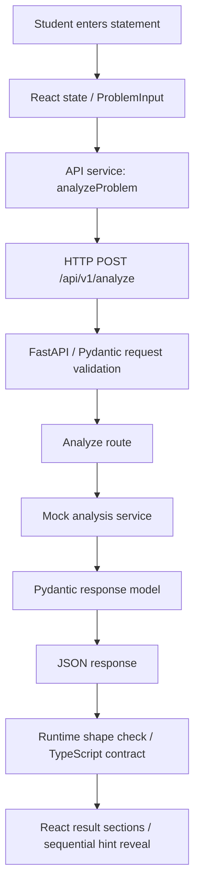

# AlgoLens AI

AlgoLens AI is a competitive programming learning assistant under development. Problem statements often mix stories with the operations, conditions, and constraints a student needs to understand. AlgoLens aims to make that underlying problem easier to see while preserving its meaning and letting students reason for themselves.

**Stage 0 and Stage 1 are complete. Stage 2 — LLM integration — is next.** The full browser-to-API workflow works with explicitly labeled mock data. Real AI analysis is not implemented.

## Working today

- A responsive React page with a reusable problem input, character count, Clear, and Analyze Problem controls.
- `POST /api/v1/analyze`: Pydantic trims and validates the statement; a separate mock service returns a typed response.
- Structured Problem Essence, Constraints, Complexity Guidance, Possible Techniques, and Progressive Hints sections.
- Three demo hints, hidden initially and revealed in order. Every result states that it is a fixed example unrelated to the submitted problem; confidence scores are omitted.
- Loading, request timeout, validation and network/server error states; failed requests preserve the statement for retry. Editing or clearing the statement removes stale results and resets hints.
- A backend connection indicator with timeout and manual recheck.
- `GET /api/v1/health` returning `{"status":"ok","service":"algolens-api"}`.
- A versioned API, local GET/POST CORS configuration, backend tests, and desktop/mobile browser workflow tests.

The statement is sent to the configured local API but is not saved in a database or used to infer anything. Every valid request receives the same array-and-range-query teaching example. No keyword matching or LLM is used.

Planned capabilities include problem simplification, constraint extraction, cautious complexity guidance, technique hypotheses, progressive Socratic hints, and curated algorithmic similarity search. Later research will explore canonical representations, embeddings, reranking, and independently evaluated models. See [the roadmap](docs/ROADMAP.md).

## Stack and layout

React, TypeScript, Vite, and Tailwind CSS power the browser. Python 3.11+, FastAPI, Pydantic, and Uvicorn power the API. pytest and httpx support backend tests; Playwright is a development-only browser test dependency. This is a modular monolith with no database or external AI dependency.

```text
AlgoLens/                  # repository root
├── frontend/
│   ├── src/
│   │   ├── components/    # problem input, results/hints, health indicator
│   │   ├── services/      # browser HTTP requests
│   │   ├── types/         # TypeScript API contracts
│   │   └── App.tsx        # single application page
│   ├── tests/             # real browser workflow and controlled failure tests
│   ├── playwright.config.ts
│   └── package.json
├── backend/
│   ├── app/
│   │   ├── api/routes/    # HTTP endpoint handlers
│   │   ├── core/          # environment configuration
│   │   ├── schemas/       # Pydantic contracts
│   │   ├── services/      # deterministic mock analysis implementation
│   │   └── main.py        # creates and configures FastAPI
│   ├── tests/
│   └── pyproject.toml
├── docs/                  # architecture, roadmap, decisions, learning notes
├── .env.example           # backend configuration example
└── AGENTS.md              # future contributor instructions
```

The single page stays in App.tsx; create a pages directory when additional pages justify it. Future feature modules will be added when implemented.

## Windows PowerShell setup

Prerequisites: Git, Python 3.11 or newer (tested here with 3.13), and a supported Node.js release at least 22.12 (tested here with 24). Run commands from the repository root unless stated otherwise. We use `npm.cmd` because PowerShell execution policy may block `npm.ps1`. Calling the virtual environment's Python directly also avoids activation-policy changes. `rtk` is optional for human setup; future agents follow AGENTS.md.

```powershell
# Backend installation
python -m venv backend/.venv
backend/.venv/Scripts/python.exe -m pip install -e './backend[dev]'

# Frontend installation (lockfile records the resolved dependency versions)
Set-Location frontend
npm.cmd ci
Set-Location ..

# Optional local settings; defaults work without these copies
Copy-Item .env.example .env
Copy-Item frontend/.env.example frontend/.env
```

If Python is not on PATH, install Python 3.11+ and reopen the terminal. The backend dependencies have bounded compatible ranges in pyproject.toml; the observed versions from verification are documented in docs/LEARNING_LOG.md. Python dependencies are not yet locked, so future installs can resolve newer compatible versions.

Run the backend in terminal 1:

```powershell
Set-Location C:\Coding\AlgoLens\backend
.venv/Scripts/python.exe -m uvicorn app.main:app --reload --host 127.0.0.1 --port 8000
```

Run the frontend in terminal 2:

```powershell
Set-Location C:\Coding\AlgoLens\frontend
npm.cmd run dev
```

Open <http://127.0.0.1:5173>. API documentation is at <http://127.0.0.1:8000/docs> and health is at <http://127.0.0.1:8000/api/v1/health>. Stop either server with Ctrl+C. Vite uses strict port 5173 so an occupied port produces an actionable error instead of silently invalidating the CORS origin.

## Configuration and request flow

The backend loads the root `.env` independently of the current working directory; existing process environment variables take precedence. `CORS_ORIGINS` is a comma-separated list of exact frontend origins, defaulting to localhost and 127.0.0.1 on port 5173. CORS governs browser access; it is not authentication.

The frontend reads `VITE_API_BASE_URL` from `frontend/.env`, defaulting to `http://127.0.0.1:8000`. Restart Vite after configuration changes; production frontend variables are embedded at build time. Every `VITE_*` variable is public. Future LLM credentials must remain on the backend.

On page load, `HealthIndicator` calls `getHealth`. Analyze Problem calls `analyzeProblem`, sending JSON to the versioned API. The browser applies a 15-second request timeout and validates the returned shape before rendering it. No API key is needed.

## Analysis API contract

`POST /api/v1/analyze` accepts `{"statement":"competitive programming problem..."}`. The statement must be a string containing **20–20,000 Unicode code points after trimming surrounding whitespace**, inclusive. These limits allow full statements while rejecting accidental oversized inputs. The browser shows the same trimmed count. The limit is on this field, not the entire HTTP body. Empty, whitespace-only, missing, non-string, too-short, too-long, and malformed JSON requests return FastAPI's standard HTTP 422 validation response.

The response contains:

| Field | Shape |
| --- | --- |
| `analysis_type` | Literal `"mock"` |
| `demo_notice` | Explicit warning that this is fixed data unrelated to the input |
| `simplified_problem` | Description of the teaching example |
| `constraints` | Objects with `variable`, `description` |
| `complexity_guidance` | Objects with `complexity`, `assessment`, `explanation` |
| `possible_techniques` | Objects with `name`, `explanation`; no confidence scores |
| `hints` | Three objects with `level` (1, 2, 3) and `text` |

Try it in `/docs` or PowerShell:

```powershell
Invoke-RestMethod -Method Post -Uri http://127.0.0.1:8000/api/v1/analyze -ContentType 'application/json' -Body '{"statement":"Given an array of integers, process the queries described below."}'
```

## Verification commands

```powershell
# From repository root
backend/.venv/Scripts/python.exe -m pytest backend/tests -q

Set-Location frontend
npm.cmd run typecheck
npm.cmd run build
# Stop manually started frontend/backend servers before browser tests.
# Uses the installed Microsoft Edge browser and starts/stops both servers.
npm.cmd test
# Optional local inspection of the production build
npm.cmd run preview
```

The build includes application TypeScript checking. pytest checks health, request validation and boundaries, typed response fields, deterministic mock output, malformed JSON, and CORS. Playwright runs nine scenarios at desktop and 390px viewports, including actual API requests, loading/duplicate submission protection, progressive hints, failure/retry, malformed responses, and health recovery. Fault cases use explicit browser network interception; the successful round trip uses the real FastAPI service.

Browser tests require Microsoft Edge installed, an initialized backend/.venv, and free ports 5173 and 8000. To use another supported installed browser, change `channel` in playwright.config.ts. The config selects the virtual environment's Windows or POSIX Python path automatically. Screenshots and failure traces are ignored under frontend/test-results. Test servers override only the public API base URL; keep local CORS configured to allow the default test origin `http://127.0.0.1:5173`.

Verified for Stage 1: **18 backend tests passed**, **18 browser tests passed**, and **the production build passed**. Backend tests emit an upstream Starlette/httpx TestClient deprecation warning. Playwright emits an environment color-setting warning; neither failed verification. See docs/LEARNING_LOG.md for the actual verification record.

Manual checks:

1. Submit at least 20 characters and inspect the POST request/JSON in the browser Network panel. Confirm the mock warning and five result sections.
2. Reveal hints 1, 2, and 3 in order; edit the statement and submit again to check reset behavior.
3. Try whitespace-only, fewer than 20, and more than 20,000 characters. The button should remain disabled with guidance where appropriate.
4. Stop the backend and submit a valid statement. Confirm the readable error, preserved input, and successful retry after restarting it. Recheck the health indicator separately.
5. Check keyboard navigation, focus visibility, readable text, and a narrow viewport. Loading locks the textarea and both buttons while a request is pending.

If you rename the repository again, refresh the editable install from the new root with `backend/.venv/Scripts/python.exe -m pip install -e './backend[dev]'`. Virtual environments can contain absolute paths; recreating backend/.venv from the setup commands is the most reliable option if other tools still point at the old location.

## Learn the foundation

Read these first, in request-flow order: `frontend/src/components/ProblemInput.tsx`, `frontend/src/App.tsx`, `frontend/src/services/api.ts`, `backend/app/api/routes/analyze.py`, `backend/app/schemas/analysis.py`, `backend/app/services/analysis_service.py`, `frontend/src/types/api.ts`, `frontend/src/components/AnalysisResult.tsx`, `backend/tests/test_analyze.py`, and `frontend/tests/workflow.spec.ts`.



Pydantic checks incoming values at runtime and validates the response contract. The route handles HTTP, while the service contains the use case; this lets Stage 2 replace the mock implementation without filling the route with provider details. TypeScript types mirror the backend so rendering code knows the expected fields, but the API client still checks network data because TypeScript types disappear at runtime.

- **Frontend versus backend:** browser code handles interactions; the server owns validation, future business logic, and credentials. Separate directories let each use its own language, dependencies, and tooling while remaining one project.
- **FastAPI and endpoints:** FastAPI turns Python route functions into HTTP APIs. An endpoint is a method/path pair such as GET `/api/v1/health`, with a defined request and response contract. Uvicorn runs the application as a server.
- **React, TypeScript, Vite, Tailwind:** React composes UI and updates it from state. TypeScript checks code before it runs. Vite serves development files and bundles production assets. Tailwind provides CSS utilities for consistent styling.
- **Pydantic:** it validates the trimmed statement and typed mock response. During LLM integration it will also validate structured model outputs; validation of shape alone does not establish algorithmic correctness.
- **Future LLM boundary:** a backend service will call the provider and return validated data through the API. The browser must never call the provider with a secret key.
- **Environment variables:** they separate machine-specific settings and secrets from source code; examples document names without sharing credentials.

See [architecture](docs/ARCHITECTURE.md), [decisions](docs/DECISIONS.md), and [learning log](docs/LEARNING_LOG.md) for the reasoning behind this structure.

## Limits and next milestone

There is no real statement understanding, technique prediction, constraint extraction, complexity estimator, hint generation, retrieval, persistence, scraping, authentication, or LLM call. All displayed analysis and hints are demo content. Refreshing clears the input. Hint reveal is a UI convenience: all three hints arrive in the JSON response. Health reports API process availability, not AI readiness. Nothing has been deployed.

Mocks let us verify the contracts, validation, network flow, error states, and UI independently of model costs and variability. **Next task — Stage 2:** add a backend-only LLM provider boundary for a validated, story-free problem representation; define semantic evaluation examples and test malformed output, timeout, and provider failures. Decide explicitly how fields that remain mock or unavailable are represented. Keep credentials server-side and do not imply that the later constraint estimator or hint generation is implemented. Stage 2 requires a new authorized task.
