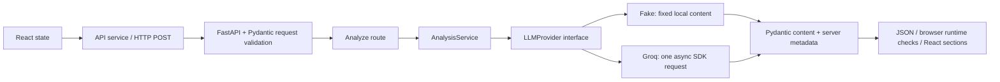

# AlgoLens AI

AlgoLens helps students understand competitive programming statements without immediately revealing complete solutions. It separates the underlying task from narrative and presents objectives, input/output requirements, raw constraints, technique hypotheses, preliminary complexity guidance, observations, uncertainties, and three progressive hints.

**Status:** Stages 0–1 are complete. Stage 2's fake/Groq implementation is in place and verified offline. **Live Groq acceptance and semantic evaluation remain manual and unverified; Stage 2 is not yet marked complete.** No live inference was performed during implementation, startup, tests, or builds.

## ₹0 workflow

- `LLM_PROVIDER=fake` is the default: an explicitly labeled fixed example, no key, internet connection, model download, GPU, or API quota required after dependencies are installed.
- `LLM_PROVIDER=groq` enables one live request only when a user submits Analyze Problem. Use a Groq **Free** account; do not add payment information or upgrade to a paid plan for this project.
- Groq free-tier availability and limits depend on the account and can change. If free access is unavailable, keep fake mode. The application cannot determine an account's billing plan from a key.
- No OpenAI API, paid provider, paid fallback, automatic model switch, or automatic retry exists. The `openai/gpt-oss-*` names identify open-weight models hosted by Groq; they do not invoke OpenAI's paid API.

Groq currently documents both requested GPT-OSS models in its [model catalog](https://console.groq.com/docs/models), [structured-output support](https://console.groq.com/docs/structured-outputs), and [free-plan limits](https://console.groq.com/docs/rate-limits). Check the account's [Limits page](https://console.groq.com/settings/limits) before enabling live use. No permanent or unlimited free-service promise is made.

## What works

- Responsive React form with trimmed character count, validation, Clear, loading protection, and preserved text on failure.
- `GET /api/v1/health` returns `{"status":"ok","service":"algolens-api"}` without contacting any provider.
- `POST /api/v1/analyze` validates the statement, selects a provider through the analysis service, and returns a validated structured response.
- FakeLLMProvider supports offline development; GroqProvider uses the official async Groq SDK with strict JSON Schema output and Pydantic validation.
- The UI distinguishes **Demo Mode** from **AI Analysis**, identifies provider/model, renders nine result sections, and reveals hints sequentially. Technique suggestions remain hypotheses; no fabricated confidence percentages appear.
- Controlled errors cover missing/invalid configuration, rate limits, timeout, invalid output, provider unavailability, and internal failures. No raw SDK errors are returned.
- Local CORS configuration, backend tests, and desktop/narrow-viewport browser tests.

## Stack and folders

Frontend: React, TypeScript, Vite, Tailwind CSS. Backend: Python 3.11+, FastAPI, Pydantic, Uvicorn, python-dotenv, official Groq SDK. Testing: pytest/httpx and development-only Playwright using installed Microsoft Edge. No database or orchestration framework.

```text
AlgoLens/
├── frontend/
│   ├── src/
│   │   ├── components/    # input, results/hints, health indicator
│   │   ├── services/      # HTTP, runtime checks, controlled error messages
│   │   ├── types/         # API contracts
│   │   └── App.tsx        # input/loading/error/result state
│   ├── tests/             # browser workflows; external page requests blocked
│   └── playwright.config.ts
├── backend/
│   ├── app/
│   │   ├── api/routes/    # thin HTTP handlers
│   │   ├── core/          # settings and safe public errors
│   │   ├── llm/           # provider protocol, fake, Groq, system prompt
│   │   ├── schemas/       # content + request/response validation
│   │   ├── services/      # provider selection and server-owned metadata
│   │   └── main.py        # FastAPI, CORS, safe exception handler
│   ├── tests/             # offline defaults and mocked SDK transport
│   └── pyproject.toml
├── docs/                  # architecture, decisions, roadmap, learning/evaluation
├── .env.example           # backend-only settings; no secrets
└── AGENTS.md              # contributor rules and zero-budget policy
```

## Windows PowerShell setup

Prerequisites: Python 3.11+, Node.js at least 22.12, Git, and Microsoft Edge for browser tests. Tested here with Python 3.13.5 and Node 24.18.0. Initial package installation needs internet access; test execution does not need external services. Human commands below do not require rtk. Use `npm.cmd` to avoid PowerShell blocking npm.ps1; invoking the virtual environment's Python directly avoids activation-policy changes.

```powershell
Set-Location C:\Coding\AlgoLens
python -m venv backend/.venv
backend/.venv/Scripts/python.exe -m pip install -e './backend[dev]'
Set-Location frontend
npm.cmd ci
Set-Location ..

# Optional: preserve any existing local settings.
if (-not (Test-Path .env)) { Copy-Item .env.example .env }
if (-not (Test-Path frontend/.env)) { Copy-Item frontend/.env.example frontend/.env }
```

Existing dependencies need only the backend pip install command to pick up Stage 2's Groq SDK. No new frontend runtime package was added. If the directory is renamed, refresh the editable install using the new path; recreate backend/.venv if other tools still contain old absolute paths.

Run backend in terminal 1:

```powershell
Set-Location C:\Coding\AlgoLens\backend
.venv/Scripts/python.exe -m uvicorn app.main:app --reload --host 127.0.0.1 --port 8000
```

Run frontend in terminal 2:

```powershell
Set-Location C:\Coding\AlgoLens\frontend
npm.cmd run dev
```

Open <http://127.0.0.1:5173>. API docs: <http://127.0.0.1:8000/docs>. Health: <http://127.0.0.1:8000/api/v1/health>. Ctrl+C stops each server. Vite requires port 5173 to be free instead of silently choosing a different CORS origin.

## Configuration and manual live activation

The backend reads the **repository-root `.env`**, independently of the working directory. Process environment variables override that file. Backend/.env is ignored by Git but is not loaded automatically. Existing .env files are never overwritten by the implementation. Settings are read when handling requests; restart the backend after editing settings for a clear switch of mode.

| Variable | Default | Purpose |
| --- | --- | --- |
| `LLM_PROVIDER` | `fake` | Explicit `fake` or `groq` selection |
| `GROQ_API_KEY` | empty | Required only for live Groq; server-side secret |
| `GROQ_MODEL` | `openai/gpt-oss-120b` | Explicit alternative: `openai/gpt-oss-20b`; no automatic switch |
| `GROQ_MAX_OUTPUT_TOKENS` | `3072` | Output budget, allowed 512–4096; low reasoning effort |
| `GROQ_TIMEOUT_SECONDS` | `30` | Total provider deadline, greater than 0 and at most 40 seconds |
| `CORS_ORIGINS` | localhost/127.0.0.1:5173 | Comma-separated exact allowed browser origins |

The frontend reads `VITE_API_BASE_URL` from frontend/.env, defaulting to `http://127.0.0.1:8000`. Every `VITE_*` value is public, embedded into the browser bundle; **never place an API key there**. Frontend settings require a Vite restart/rebuild. The browser analysis deadline is 45 seconds, longer than the backend limit.

To enable live inference manually:

1. Follow Groq's [official quickstart](https://console.groq.com/docs/quickstart) to sign up/sign in and create a key at the [API Keys page](https://console.groq.com/keys). Confirm free-plan model access without a purchase. If that is unavailable, stop here and keep fake mode.
2. In the ignored root .env, set `LLM_PROVIDER=groq`, enter the key as `GROQ_API_KEY`, and choose one of the two supported model IDs. Keep the other defaults initially. Do not paste the key into chat, source code, tests, or React.
3. Restart the backend, open the frontend, and deliberately submit one problem. This is the first action that should consume Groq quota. A successful response is labeled AI Analysis with provider/model metadata.
4. Review semantic preservation and hint restraint using [the manual evaluation checklist](docs/EVALUATION.md). Do not treat JSON validity as evidence of correctness.
5. Set `LLM_PROVIDER=fake` to return to offline Demo Mode. Fake mode ignores credentials and does not call the SDK.

Groq's SDK normally retries some failures; this adapter explicitly sets `max_retries=0`. A 429 response produces a free-tier-capacity message and preserves the statement. Wait for capacity or switch to fake mode; a manual Analyze click is a new request. Timeouts, authentication/model-access errors, or malformed/truncated output do not trigger a paid provider, another model, a repair call, or hidden retries. Long inputs may exceed account token limits even though they fit the character limit. Lowering the output budget too far can truncate results, which are rejected.

## API contract and validation

Request: `POST /api/v1/analyze` with `{"statement":"competitive programming problem..."}`. A strict string of **20–20,000 Unicode code points after trimming** is required. Missing/non-string/empty/short/oversized statements and malformed JSON use standard FastAPI HTTP 422 responses. The bound is on the statement field, not the full HTTP body.

The response preserves Stage 1's structured fields and adds objective, I/O, observations, uncertainties, and metadata:

| Field | Shape |
| --- | --- |
| `analysis_type`, `provider`, `model` | `mock` / `fake` / null, or `ai` / `groq` / configured model; set by the server |
| `demo_notice` | Explicit unrelated-example warning in fake mode; null for AI |
| `simplified_problem` | Story-free description |
| `objective`, `input_summary`, `output_summary` | Text or explicit null when unavailable |
| `constraints` | `variable`, raw `expression` or null, short `description` |
| `complexity_guidance` | `complexity`, cautious `assessment`, `explanation` |
| `possible_techniques` | `name`, `explanation`; hypotheses, no confidence percentages |
| `important_observations`, `uncertainties` | Lists of text; evidence lists may be empty |
| `hints` | Exactly three entries in level 1, 2, 3 order, each with text |

All generation fields are required; nullable semantic values use explicit null unions. All generation objects forbid extra properties. Pydantic rejects invalid types, blank text, fenced code blocks, missing fields, and wrong hint counts/order. The generation schema excludes provider metadata entirely. The browser checks response shape and metadata consistency before rendering.

All three hints arrive in one response. Reveal buttons change local state and make no API calls. They are a learning convenience, not a server-side secrecy boundary. Provider failures use safe `{ "detail": { "code": "...", "message": "..." } }` errors: configuration 503, quota 429, timeout 504, invalid output 502, unavailable 503, unexpected internal error 500.

## Tests and build — no model requests

Stop manually started frontend/backend servers before browser tests so ports 5173 and 8000 are free. Tests require installed dependencies but no keys or external connection.

```powershell
Set-Location C:\Coding\AlgoLens
backend/.venv/Scripts/python.exe -m pytest backend/tests -q
Set-Location frontend
npm.cmd run build
npm.cmd test
```

Backend tests ignore local .env content, force fake defaults, block external DNS/socket connections, and use httpx.MockTransport for the actual Groq SDK. Browser tests start their own servers with `LLM_PROVIDER=fake` and an empty key, override live settings, and block external page requests. The AI UI branch uses an explicit response fixture rather than live inference. Existing servers are never reused. Installed Microsoft Edge is required; screenshots/traces are ignored under frontend/test-results.

Observed Stage 2 checks: **54 backend tests passed**, **24 desktop/narrow-viewport browser tests passed**, and **frontend production build passed**. The existing Starlette/httpx TestClient deprecation warning and Playwright color-setting warning remain non-failing. See [learning log](docs/LEARNING_LOG.md). Live account access, semantic quality, and Groq's acceptance of the schema remain unverified by a live request.

Manual UI checks: submit a valid statement, inspect Network JSON, verify the mode/provider label, reveal hints in sequence, edit/resubmit to reset them, try invalid lengths, stop the backend to check preserved input/errors, and retry after restarting it. Check keyboard navigation and a narrow viewport.

## Understand the request flow



A provider abstraction is a small contract: given a statement, asynchronously return AnalysisContent. Fake and Groq implement the same contract, so routes and components do not depend on SDK-specific objects. Groq sends a system policy plus the statement as untrusted user data; its Chat Completions response is parsed and checked by Pydantic. JSON Schema describes allowed fields/types to the provider, while Pydantic enforces runtime structure and extra Python invariants. Neither proves the model preserved semantics or avoided revealing too much.

Environment variables separate machine settings and credentials from code. React runs on the student's machine and its bundle is inspectable, so credentials must stay in the backend. CORS permits the configured browser origin to read backend responses; it is not authentication. One request, bounded tokens/time, no retries, and local-only hint reveal reduce quota usage. A future OllamaProvider can implement the same content contract; extending provider metadata/types will not require changing the route or result components. Ollama is not implemented.

Read these files in order:

| File | What to understand |
| --- | --- |
| frontend/src/App.tsx | State, submission lifecycle, input preservation |
| frontend/src/services/api.ts | JSON POST, deadlines, runtime checks and safe errors |
| backend/app/api/routes/analyze.py | Thin route and dependency injection |
| backend/app/services/analysis_service.py | Provider selection and trusted metadata |
| backend/app/llm/base.py | Small provider protocol |
| backend/app/llm/fake_provider.py | Offline fixed teaching example |
| backend/app/llm/groq_provider.py | Async SDK, strict schema, deadlines, zero retries |
| backend/app/llm/prompts.py | Semantics, untrusted-input and hint policy |
| backend/app/schemas/analysis.py | Generation schema and Python validation |
| backend/app/core/config.py | Root .env, environment precedence, secret handling |

Then read frontend/src/components/AnalysisResult.tsx and backend/tests/test_providers.py to connect rendering and failure behavior to those contracts.

## Limits and next milestone

LLM output can be incorrect or follow malicious instructions despite prompt precautions. Structural validation and a code-fence rejection are not semantic or solution-disclosure proofs. No account billing status or live output quality was verified here. Input is sent to Groq only in explicitly enabled Groq mode; application code does not persist statements, log request bodies, keys, or raw provider errors. Health checks do not establish Groq readiness.

There is no database, authentication, retrieval, scraping, URL fetching, deterministic complexity engine, embeddings, training, cloud hosting, paid API, or Ollama implementation. Raw LLM constraints and complexity suggestions are preliminary. Nothing was committed or deployed by this task.

Next: complete the manual Stage 2 acceptance/evaluation checklist. After that, the planned Stage 3 is constraint normalization and a deterministic, assumption-aware complexity estimator. Do not start it automatically. See [roadmap](docs/ROADMAP.md), [architecture](docs/ARCHITECTURE.md), and [decisions](docs/DECISIONS.md).
