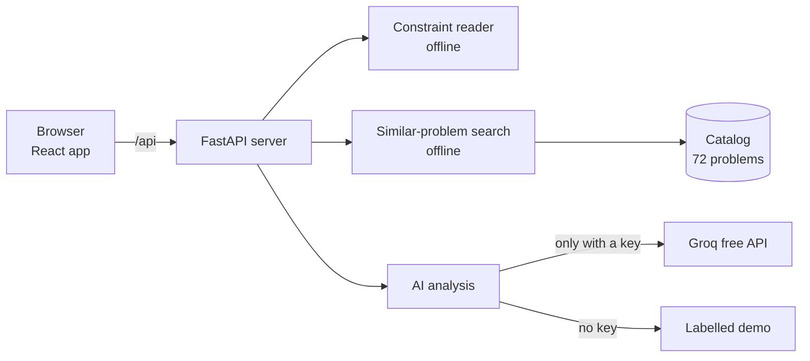

# AlgoLens

**Read the problem. Find the algorithm hiding in the story.**

AlgoLens is a learning tool for competitive programming. You paste a problem statement, and it helps you work out *which idea* the problem needs, without handing you the full solution.

It gives you three things:

1. **A constraint check.** It reads limits such as `1 ≤ n ≤ 2·10⁵` and shows which running times (O(n), O(n log n), O(n²)…) will fit. This runs offline, with no AI.
2. **An AI explanation with three hints.** The story is turned into a plain task, followed by hints that go from a gentle nudge to a near-solution idea. You reveal them one at a time.
3. **Similar practice problems.** A local search finds related problems from a catalog of 72 (58 written for this project and 14 licensed problems from Kattis). If nothing in the catalog is close, it says so.

The whole project runs on a **₹0 budget**: free tools only, and the AI is called only when you ask for an analysis.

> **Status:** Stages 0–6 are complete, plus the local part of Stage 8 (security, logging, CI). Stage 7 (training a custom model) is on hold until there is enough reviewed data. Online hosting is planned. See the [roadmap](docs/ROADMAP.md).

---

## Contents

- [How it works](#how-it-works)
- [Quick start](#quick-start)
- [Turn on AI analysis](#turn-on-ai-analysis-optional)
- [Try it](#try-it)
- [Settings](#settings)
- [Run the tests](#run-the-tests)
- [Results](#results)
- [Project structure](#project-structure)
- [Limitations](#limitations)
- [Documentation](#documentation)

---

## How it works

The browser shows the page. A Python server does all the work. Only one step can leave your computer: the AI call, and only when you have set a key and clicked **Analyze Problem**.



| Part | How it works |
| --- | --- |
| **Constraint reader** | Turns copied notation into plain text, reads numbers with a small safe grammar (never runs text as code), works out what each number means ("array of n integers", "q queries"), then estimates nine growth curves from O(1) to O(n!). Up to 10⁶ steps is *promising*, up to 10⁸ *possibly feasible*, above that *likely too slow*. These are teaching guides, not verdicts. |
| **AI analysis** | One request to a free Groq model (`openai/gpt-oss-120b`). The reply must match a strict structure, with exactly three hints, or it is rejected. There are no automatic retries, and at most 10 AI calls per minute. Without a key, a clearly labelled **Demo Mode** example is shown instead. |
| **Similar-problem search** | TF-IDF text matching (with plural folding) plus about 23 hand-written **task cues**, such as fixed data vs. updates or negative vs. non-negative weights. Final score = 0.8 × text + 0.2 × cues. Technique names are never part of the searched text. A **"No close match"** notice appears when your topic isn't covered. |

More detail: [architecture](docs/ARCHITECTURE.md) · [constraint reader](docs/DETERMINISTIC_ANALYSIS.md) · [search](docs/RETRIEVAL.md).

---

## Quick start

These steps are for **Windows PowerShell**. On macOS/Linux, use `backend/.venv/bin/python` and `npm` instead.

**You need:** Python 3.11+, Node.js 22.12+, Git, and Microsoft Edge (only for browser tests).

### 1. Install (once)

```powershell
cd C:\path\to\AlgoLens
python -m venv backend/.venv
backend/.venv/Scripts/python.exe -m pip install -e './backend[dev]'
cd frontend
npm.cmd ci
cd ..
if (-not (Test-Path .env)) { Copy-Item .env.example .env }
```

> Use `npm.cmd` (not `npm`) so PowerShell does not block the script.

### 2. Start the two servers

Terminal 1 (backend):

```powershell
cd C:\path\to\AlgoLens\backend
.venv/Scripts/python.exe -m uvicorn app.main:app --reload --host 127.0.0.1 --port 8000
```

Terminal 2 (frontend):

```powershell
cd C:\path\to\AlgoLens\frontend
npm.cmd run dev
```

### 3. Open the app

Go to **<http://127.0.0.1:5173>**. It starts in **Demo Mode**, which needs no key and no internet.

Useful links: API docs at <http://127.0.0.1:8000/docs> · health check at <http://127.0.0.1:8000/api/v1/health>.

### Open it on your phone (same Wi-Fi)

Start the frontend with `npm.cmd run dev:lan` instead, and open the **Network** address it prints (for example `http://192.168.1.20:5173`). Only the web page is shared; the backend, which holds your AI key, stays private on your computer.

On Windows, allow port 5173 once in an **admin** PowerShell:

```powershell
New-NetFirewallRule -DisplayName "AlgoLens dev (LAN only)" -Direction Inbound -Protocol TCP -LocalPort 5173 -RemoteAddress LocalSubnet -Action Allow
```

> Anyone on the same Wi-Fi can then use the app, including your AI quota if a key is set. Stop the server when you are done sharing.

---

## Turn on AI analysis (optional)

1. Create a free account and an API key at [console.groq.com/keys](https://console.groq.com/keys). Use the **Free** plan; never add payment details for this project.
2. Open the `.env` file in the **project folder** (not inside `backend/`) and set:

   ```env
   LLM_PROVIDER=groq
   GROQ_API_KEY=your-key-here
   ```

3. Restart the backend. **Analyze Problem** now shows **AI Analysis** with the provider and model name.

To go back to Demo Mode, set `LLM_PROVIDER=fake`.

**Keep your key safe:**

- The key lives only in `.env`, which git ignores. Never paste it into code, chat or the frontend.
- Anything named `VITE_*` is built into the public web page, so never put a key there.

Free-tier limits are set by Groq and can change. If you hit a limit (HTTP 429), use **Assess constraints only** (no AI needed), wait a minute, or switch back to Demo Mode.

---

## Try it

Paste this and click **Assess constraints only**:

```text
Given an array of n integers, determine whether it is sorted.
1 ≤ n ≤ 2 × 10⁵
Time limit: 2 seconds
```

You should see about 200,000 steps for O(n) (*promising*), 3.52 million for O(n log n) (*possibly feasible*) and 40 billion for O(n²) (*likely too slow*).

Then try a sum-over-test-cases limit:

```text
There are t test cases, each with an array of n integers.
1 <= t <= 10000
1 <= n <= 1000
The sum of n over all test cases does not exceed 2000
```

The total linear work is **2,000**, not 10,000 × 1,000. AlgoLens uses the sum rule.

For the search, click **Find similar problems** with:

```text
Find inclusive interval sums for many queries on a fixed signed array.
```

**Static ledger totals** should be near the top. Kattis problems show a link to the original page and a credit line.

> AlgoLens never opens websites. If you paste only a link, it asks you to paste the problem text instead.

---

## Settings

All backend settings live in the `.env` file in the project folder. Values set in your shell take priority. Restart the backend after changing them.

| Setting | Default | What it does |
| --- | --- | --- |
| `LLM_PROVIDER` | `fake` | `fake` (Demo Mode) or `groq` (real AI) |
| `GROQ_API_KEY` | empty | Your Groq key; needed only for `groq` |
| `GROQ_MODEL` | `openai/gpt-oss-120b` | Or `openai/gpt-oss-20b`; never switched automatically |
| `GROQ_MAX_OUTPUT_TOKENS` | `3072` | Answer length budget (512–4096) |
| `GROQ_TIMEOUT_SECONDS` | `30` | Time limit for one AI call (max 40) |
| `GROQ_REQUESTS_PER_MINUTE` | `10` | Local cap on AI calls (1–60), to protect your free quota |
| `RETRIEVAL_METHOD` | `tfidf` | `tfidf`, or `semantic` (needs the optional MiniLM setup below) |
| `RETRIEVAL_TOP_K` | `5` | Number of results from the API (1–20); the page shows up to 5 |
| `RETRIEVAL_RERANK` | `cues` | `cues` (task cues on) or `none` (text only) |
| `CORS_ORIGINS` | `localhost` / `127.0.0.1:5173` | Only needed if the page calls the backend from another address |

The frontend needs no settings. It calls `/api` on its own address, and Vite forwards those calls to the backend (`ALGOLENS_API_TARGET`, default `http://127.0.0.1:8000`).

### Optional: MiniLM semantic search

MiniLM is a small pre-trained model that matches by meaning. It needs a one-time download of about 90 MB plus a few GB of dependencies, and runs on CPU.

```powershell
backend/.venv/Scripts/python.exe -m pip install torch --index-url https://download.pytorch.org/whl/cpu
backend/.venv/Scripts/python.exe -m pip install -e './backend[semantic]'
backend/.venv/Scripts/python.exe -m app.retrieval.setup_model --download
```

Then set `RETRIEVAL_METHOD=semantic`. After setup it works fully offline. If the model is missing, search falls back to TF-IDF and says so.

---

## Run the tests

Stop your running servers first (the tests start their own on ports 5173 and 8000).

```powershell
cd C:\path\to\AlgoLens
backend/.venv/Scripts/python.exe -m pytest backend/tests -q     # 353 backend tests
cd frontend
npm.cmd run build                                               # type check + build
npm.cmd test                                                    # 74 browser tests (desktop + phone)
```

To keep your servers running, give the tests other ports: set `ALGOLENS_TEST_FRONTEND_PORT=5174` and `ALGOLENS_TEST_BACKEND_PORT=8001` before `npm.cmd test`.

The tests never use the internet or a real AI key. The AI is always replaced by a fake or a mocked network layer.

After editing the catalog or the evaluation questions, run the data checker from `backend/`:

```powershell
.venv/Scripts/python.exe -m app.retrieval.catalog_check --strict
```

GitHub Actions runs all of these on every push ([ci.yml](.github/workflows/ci.yml)).

---

## Results

Search quality is measured on 42 hand-written questions. The 14 **development** questions are used to choose settings; the 28 **held-out** questions are used only to report results.

Held-out results, current 72-problem catalog, raw statement text:

| Search | Precision@5 | Recall@5 | MRR |
| --- | --- | --- | --- |
| Text only (TF-IDF) | 0.150 | 0.528 | 0.466 |
| Text + task cues (**default**) | 0.186 | 0.683 | 0.712 |

- **Recall@5:** the share of correct problems that appear in the top 5.
- **MRR:** how high the first correct answer ranks (1.0 = always first).
- **No-match notice:** it flagged 1 of 7 questions with no answer in the catalog, and gave 0 false alarms on the 21 that have one.

These numbers are provisional. The labels are assistant-reviewed and still waiting for the project owner's sign-off ([LABEL_REVIEW.md](docs/LABEL_REVIEW.md)), and the test set is small. Full history: [RETRIEVAL.md](docs/RETRIEVAL.md).

---

## Project structure

```text
AlgoLens/
├── backend/
│   ├── app/
│   │   ├── api/routes/     # HTTP endpoints: health, analyze, assess, similar
│   │   ├── algorithmic/    # constraint reader and growth estimates
│   │   ├── llm/            # AI providers (Groq, fake demo) and the prompt
│   │   ├── retrieval/      # search, task cues, catalog checker, evaluation
│   │   ├── data/           # practice catalog and evaluation questions (JSON)
│   │   ├── schemas/        # request/response checks (Pydantic)
│   │   ├── services/       # combines the parts into one reply
│   │   ├── core/           # settings, safe errors, security
│   │   └── main.py         # app entry point
│   └── tests/              # 353 backend tests
├── frontend/
│   ├── src/
│   │   ├── components/     # page sections, results, hints
│   │   ├── backgrounds/    # animated notation background
│   │   ├── services/       # API calls and response checks
│   │   ├── types/          # API types
│   │   └── App.tsx         # main page
│   └── tests/              # 74 browser tests
├── docs/                   # design, decisions, results, security
├── .env.example            # settings template (no secrets)
└── AGENTS.md               # rules for contributors and AI assistants
```

**API endpoints:**

| Endpoint | Purpose |
| --- | --- |
| `GET /api/v1/health` | Is the server up? |
| `POST /api/v1/assess` | Constraint check only (no AI) |
| `POST /api/v1/similar` | Similar problems only (no AI) |
| `POST /api/v1/analyze` | Everything: constraint check, AI analysis with hints, similar problems |

Requests take `{"statement": "..."}` with 20–20,000 characters. Errors always come back as safe JSON, such as 429 for rate limits, 413 for oversized requests and 503 when the AI is unavailable, and never include internal details.

---

## Limitations

- **The AI can be wrong.** Its replies are checked for structure, not correctness.
- **Hints are not secret.** All three arrive together; the reveal buttons are a study aid.
- **The constraint reader covers common English patterns only.** Unusual wording and symbolic formulas are reported as unknown rather than guessed. Feasibility labels are rough guides, not judge verdicts.
- **The catalog is small (72 problems).** Topics such as string matching, number theory, games and max flow are missing.
- **No login and no online hosting yet.** The app is meant to run on your own computer or Wi-Fi.

What AlgoLens deliberately does **not** use: databases, web scraping, paid APIs, model training, or automatic retries and fallbacks.

---

## Documentation

| Document | What's inside |
| --- | --- |
| [ARCHITECTURE.md](docs/ARCHITECTURE.md) | How the parts fit together |
| [DETERMINISTIC_ANALYSIS.md](docs/DETERMINISTIC_ANALYSIS.md) | The constraint reader: rules, formulas, limits |
| [RETRIEVAL.md](docs/RETRIEVAL.md) | Search design, data, labels and every measured result |
| [LABEL_REVIEW.md](docs/LABEL_REVIEW.md) | Labelling policy and the sign-off checklist |
| [EVALUATION.md](docs/EVALUATION.md) | Checklist for reviewing real AI hints |
| [SECURITY.md](docs/SECURITY.md) | Security review: issues found and fixed |
| [DECISIONS.md](docs/DECISIONS.md) | Log of every important design decision |
| [ROADMAP.md](docs/ROADMAP.md) | Stages 0–8: done and planned |
| [LEARNING_LOG.md](docs/LEARNING_LOG.md) | Notes and lessons along the way |

**Contributing:** read [AGENTS.md](AGENTS.md) first. In short: keep changes small and tested, keep the budget at ₹0, never commit keys, never invent problem links or results, and choose search settings on the development set only.
