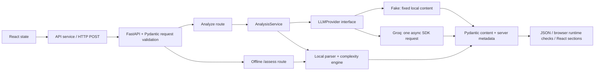

# AlgoLens AI

AlgoLens helps students understand competitive programming statements without immediately revealing complete solutions. It separates the underlying task from narrative and presents objectives, input/output requirements, raw constraints, technique hypotheses, preliminary complexity guidance, observations, uncertainties, and three progressive hints.

**Status:** Stages 0–5 are implemented and verified. Stage 5 adds 14 original hard-negative catalog records (50 total), a held-out test split (36 queries: 14 dev, 22 test), and deterministic task-cue reranking that is on by default. Evaluation labels remain provisional for the user's later review. Groq, deterministic assessment, progressive hints, and mathematical paste guidance are preserved. No live Groq calls were made during Stages 4–5. Stage 6 provenance groundwork and the local part of Stage 8 (security hardening, request logs, CI) are also complete; Stage 7 (trained models) is gated. See [the security audit](docs/SECURITY.md).

## ₹0 workflow

- `LLM_PROVIDER=fake` is the default: an explicitly labeled fixed example, no key, internet connection, model download, GPU, or API quota required after dependencies are installed.
- **Assess constraints only** works locally with either provider configured, including when Groq is unavailable. It analyzes your actual statement and uses zero AI quota.
- **Find similar problems** searches the local original practice catalog with zero AI quota. TF-IDF is the default; optional MiniLM embeddings use CPU and a deliberately downloaded local model.
- `LLM_PROVIDER=groq` enables one live request only when a user submits Analyze Problem. Use a Groq **Free** account; do not add payment information or upgrade to a paid plan for this project.
- Groq free-tier availability and limits depend on the account and can change. If free access is unavailable, keep fake mode. The application cannot determine an account's billing plan from a key.
- No OpenAI API, paid provider, paid fallback, automatic model switch, or automatic retry exists. The `openai/gpt-oss-*` names identify open-weight models hosted by Groq; they do not invoke OpenAI's paid API.

Groq currently documents both requested GPT-OSS models in its [model catalog](https://console.groq.com/docs/models), [structured-output support](https://console.groq.com/docs/structured-outputs), and [free-plan limits](https://console.groq.com/docs/rate-limits). Check the account's [Limits page](https://console.groq.com/settings/limits) before enabling live use. No permanent or unlimited free-service promise is made.

## What works

- Responsive React form with trimmed character count, validation, Clear, loading protection, and preserved text on failure.
- `GET /api/v1/health` returns `{"status":"ok","service":"algolens-api"}` without contacting any provider.
- `POST /api/v1/analyze` validates the statement, selects a provider through the analysis service, and returns a validated structured response.
- `POST /api/v1/assess` extracts constraints and estimates growth without initializing any provider or reading its settings. The same deterministic assessment is included in a successful combined analysis.
- FakeLLMProvider supports offline development; GroqProvider uses the official async Groq SDK with strict JSON Schema output and Pydantic validation.
- The UI distinguishes **Demo Mode** from **AI Analysis**, identifies provider/model, renders nine result sections, and reveals hints sequentially. Technique suggestions remain hypotheses; no fabricated confidence percentages appear.
- Controlled errors cover missing/invalid configuration, rate limits, timeout, invalid output, provider unavailability, and internal failures. No raw SDK errors are returned.
- Local CORS configuration, backend tests, and desktop/narrow-viewport browser tests.
- Original constraint evidence, normalized numeric bounds, contextual size roles, test-case/aggregate scopes, explicit ambiguity, and separate time/memory limits.
- Nine growth profiles from constant through factorial, plus conditional two-parameter profiles when meanings and bounds are known. All estimates are heuristics, not runtime or verdict predictions.
- `POST /api/v1/similar` returns up to K original practice examples (default 5, maximum 20). The dashboard shows at most five, with method, score, provenance, and limitations. Integrated recommendations start collapsed because they include technique tags.
- Cached TF-IDF and local-only Sentence Transformers retrieval share solution-free task representations. Missing semantic setup falls back visibly to TF-IDF. Retrieval adds no Groq calls and its failure does not discard a successful analysis.

## Stack and folders

Frontend: React, TypeScript, Vite, Tailwind CSS. Backend: Python 3.11+, FastAPI, Pydantic, Uvicorn, python-dotenv, official Groq SDK, scikit-learn. Optional semantic extra: Sentence Transformers and CPU PyTorch. Testing: pytest/httpx and development-only Playwright using installed Microsoft Edge. No database or orchestration framework.

```text
AlgoLens/
├── frontend/
│   ├── src/
│   │   ├── components/    # input, results/hints, health indicator
│   │   ├── services/      # HTTP, runtime checks, controlled error messages
│   │   ├── types/         # API contracts
│   │   └── App.tsx        # input/loading/error/result state
│   ├── tests/             # browser workflows; external page requests blocked
│   └── playwright.config.ts
├── backend/
│   ├── app/
│   │   ├── api/routes/    # thin HTTP handlers
│   │   ├── algorithmic/   # safe numbers, constraint parser, growth engine
│   │   ├── data/          # original practice catalog and separate query labels
│   │   ├── retrieval/     # lexical/semantic indexes, cache, setup, evaluation
│   │   ├── core/          # settings and safe public errors
│   │   ├── llm/           # provider protocol, fake, Groq, system prompt
│   │   ├── schemas/       # content + request/response validation
│   │   ├── services/      # deterministic orchestration + provider combination
│   │   └── main.py        # FastAPI, CORS, safe exception handler
│   ├── tests/             # offline defaults and mocked SDK transport
│   └── pyproject.toml
├── docs/                  # architecture, decisions, roadmap, learning/evaluation
├── .env.example           # backend-only settings; no secrets
└── AGENTS.md              # contributor rules and zero-budget policy
```

## Windows PowerShell setup

Commands below use `C:\path\to\AlgoLens`; replace it with the folder where you cloned the repository.

Prerequisites: Python 3.11+, Node.js at least 22.12, Git, and Microsoft Edge for browser tests. Tested here with Python 3.13.5 and Node 24.18.0. Initial package installation needs internet access; test execution does not need external services. Human commands below do not require rtk. Use `npm.cmd` to avoid PowerShell blocking npm.ps1; invoking the virtual environment's Python directly avoids activation-policy changes.

```powershell
Set-Location C:\path\to\AlgoLens
python -m venv backend/.venv
backend/.venv/Scripts/python.exe -m pip install -e './backend[dev]'
Set-Location frontend
npm.cmd ci
Set-Location ..

# Optional: preserve any existing local settings.
if (-not (Test-Path .env)) { Copy-Item .env.example .env }
if (-not (Test-Path frontend/.env)) { Copy-Item frontend/.env.example frontend/.env }
```

Stage 3 added no dependencies. Stage 4 requires refreshing the backend editable install above to add scikit-learn; the neural extra remains optional. If the directory is renamed, refresh the editable install using the new path; recreate backend/.venv if other tools still contain old absolute paths.

Run backend in terminal 1:

```powershell
Set-Location C:\path\to\AlgoLens\backend
.venv/Scripts/python.exe -m uvicorn app.main:app --reload --host 127.0.0.1 --port 8000
```

Run frontend in terminal 2:

```powershell
Set-Location C:\path\to\AlgoLens\frontend
npm.cmd run dev
```

Open <http://127.0.0.1:5173>. API docs: <http://127.0.0.1:8000/docs>. Health: <http://127.0.0.1:8000/api/v1/health>. Ctrl+C stops each server. Vite requires port 5173 to be free instead of silently choosing a different CORS origin.

## Configuration and manual live activation

The backend reads the **repository-root `.env`**, independently of the working directory. Process environment variables override that file. Backend/.env is ignored by Git but is not loaded automatically. Existing .env files are never overwritten by the implementation. Settings are read when handling requests; restart the backend after editing settings for a clear switch of mode.

| Variable | Default | Purpose |
| --- | --- | --- |
| `LLM_PROVIDER` | `fake` | Explicit `fake` or `groq` selection |
| `GROQ_API_KEY` | empty | Required only for live Groq; server-side secret |
| `GROQ_MODEL` | `openai/gpt-oss-120b` | Explicit alternative: `openai/gpt-oss-20b`; no automatic switch |
| `GROQ_MAX_OUTPUT_TOKENS` | `3072` | Output budget, allowed 512–4096; low reasoning effort |
| `GROQ_REQUESTS_PER_MINUTE` | `10` | Local cap on live Groq calls, 1–60; excess returns 429 before any provider request; fake mode is unlimited |
| `GROQ_TIMEOUT_SECONDS` | `30` | Total provider deadline, greater than 0 and at most 40 seconds |
| `CORS_ORIGINS` | localhost/127.0.0.1:5173 | Comma-separated exact allowed browser origins |

The frontend reads `VITE_API_BASE_URL` from frontend/.env, defaulting to `http://127.0.0.1:8000`. Every `VITE_*` value is public, embedded into the browser bundle; **never place an API key there**. Frontend settings require a Vite restart/rebuild. The browser analysis deadline is 45 seconds, longer than the backend limit.

To enable live inference manually:

1. Follow Groq's [official quickstart](https://console.groq.com/docs/quickstart) to sign up/sign in and create a key at the [API Keys page](https://console.groq.com/keys). Confirm free-plan model access without a purchase. If that is unavailable, stop here and keep fake mode.
2. In the ignored root .env, set `LLM_PROVIDER=groq`, enter the key as `GROQ_API_KEY`, and choose one of the two supported model IDs. Keep the other defaults initially. Do not paste the key into chat, source code, tests, or React.
3. Restart the backend, open the frontend, and deliberately submit one problem. This is the first action that should consume Groq quota. A successful response is labeled AI Analysis with provider/model metadata.
4. Review semantic preservation and hint restraint using [the manual evaluation checklist](docs/EVALUATION.md). Do not treat JSON validity as evidence of correctness.
5. Set `LLM_PROVIDER=fake` to return to offline Demo Mode. Fake mode ignores credentials and does not call the SDK.

Groq's SDK normally retries some failures; this adapter explicitly sets `max_retries=0`. A 429 response produces a free-tier-capacity message and preserves the statement. Use **Assess constraints only** immediately for offline results, wait for capacity, or switch to fake mode. A manual Analyze click is a new provider request. Timeouts, authentication/model-access errors, or malformed/truncated output do not trigger a paid provider, another model, a repair call, or hidden retries. Long inputs may exceed account token limits even though they fit the character limit. Lowering the output budget too far can truncate results, which are rejected.

## API contract and validation

Request: `POST /api/v1/analyze` with `{"statement":"competitive programming problem..."}`. A strict string of **20–20,000 Unicode code points after trimming** is required. Missing/non-string/empty/short/oversized statements and malformed JSON use standard FastAPI HTTP 422 responses. The bound is on the statement field, not the full HTTP body.

The combined response preserves Stage 2's fields and adds a required server-owned `deterministic` object:

| Field | Shape |
| --- | --- |
| `analysis_type`, `provider`, `model` | `mock` / `fake` / null, or `ai` / `groq` / configured model; set by the server |
| `demo_notice` | Explicit unrelated-example warning in fake mode; null for AI |
| `simplified_problem` | Story-free description |
| `objective`, `input_summary`, `output_summary` | Text or explicit null when unavailable |
| `constraints` | `variable`, raw `expression` or null, short `description` |
| `complexity_guidance` | `complexity`, cautious `assessment`, `explanation` |
| `possible_techniques` | `name`, `explanation`; hypotheses, no confidence percentages |
| `important_observations`, `uncertainties` | Lists of text; evidence lists may be empty |
| `hints` | Exactly three entries in level 1, 2, 3 order, each with text |
| `deterministic` | `source=deterministic`, extraction, selected parameter or null, growth assessments, uncertainties, discrepancies, caveats |
| `similar_problems`, `retrieval_warning` | Optional server-owned local recommendations, or a safe warning while analysis/hints remain available |

All generation fields are required; nullable semantic values use explicit null unions. All generation objects forbid extra properties. Pydantic rejects invalid types, blank text, fenced code blocks, missing fields, and wrong hint counts/order. The generation schema excludes provider metadata, deterministic results, and retrieval; the model cannot populate these fields. The browser checks response shape, finite numeric bounds, and metadata consistency before rendering.

`POST /api/v1/assess` takes the identical validated request and returns the `AlgorithmicAssessment` object directly, without an AI/demo wrapper. Combined analysis preserves provider errors; it does not silently return partial success. The UI exposes an explicit offline action after failure. Both endpoints appear in `/docs`.

## Try Stage 3 without using Groq

Start the two servers above. Paste this self-authored example and click **Assess constraints only**, even if your root .env still selects Groq:

```text
Given an array of n integers, determine whether it is sorted.
1 ≤ n ≤ 2 × 10⁵
Time limit: 2 seconds
Memory limit: 256 MB
```

Expect original Unicode evidence, normalized `1 <= n <= 200000`, an array-length parameter, and approximately 200,000 linear units, 3.52 million n-log-n units, and 40 billion quadratic units. The configured heuristic bands label these promising, possibly feasible, and likely infeasible respectively. The time/memory limits are shown as context, without converting work to seconds or claiming memory fit.

Then try:

```text
There are t test cases, each with an array of n integers.
1 <= t <= 10000
1 <= n <= 1000
The sum of n over all test cases does not exceed 2000
```

Expect a total linear upper bound of 2,000, not 10,000 × 1,000. The quadratic total bound is 2,000 × 1,000 = 2 million, not 2,000. Constant/log profiles use at most 2,000 cases here because every n is at least 1. Aggregate exponential/factorial totals remain unavailable rather than inventing a size distribution.

Also try just `1 <= n <= 200000` with enough descriptive filler to meet the 20-character input minimum: the bound is extracted, but no size meaning is invented. Two different array lengths, element-value-only bounds, missing caps, or conflicting bounds explain why a primary estimate is unavailable. In Demo Mode, **Analyze Problem** adds the unrelated fixed provider example beside the deterministic result from your real text. In Groq mode, that action makes the existing single model request; hint reveals make none.

See [the Stage 3 guide](docs/DETERMINISTIC_ANALYSIS.md) for parsing rules, formulas, limitations, extension steps, and ten learning concepts.

Copy/paste notation: `2.10^5`, `2 . 10^5`, `2⋅10^5`, and `2·10⁵` now all produce 200000. An ASCII period is treated as multiplication only before an explicit power of ten, with a visible interpretation note. Ordinary decimals/scientific notation remain unchanged. Unsupported dotted bounds are not silently truncated to `2`. After updating the code, restart the backend if it is not running with `--reload`.

All three hints arrive in one response. Reveal buttons change local state and make no API calls. They are a learning convenience, not a server-side secrecy boundary. Provider failures use safe `{ "detail": { "code": "...", "message": "..." } }` errors: configuration 503, quota 429, timeout 504, invalid output 502, unavailable 503, unexpected internal error 500. Request-level protections add `local_rate_limit` 429 (Groq mode only) and `request_too_large` 413 (bodies over 256 KiB).

## Stage 4: local similar-problem retrieval

Click **Find similar problems** for standalone local search, or **Analyze Problem** to include recommendations beside the existing analysis. Fake mode searches your actual input, never its unrelated demo simplification. AI mode reuses its existing simplification only when the provider reports no uncertainties; this is a heuristic, not independent verification. The response records which query was used.

Try: `Find inclusive interval sums for many queries on a fixed signed array.` Expect **Static ledger totals** near the top. Every record is labeled **AlgoLens practice example** and has no external link. A cosine score is a ranking signal, not a probability of needing the same algorithm.

`POST /api/v1/similar` accepts `{"statement":"problem statement...","k":5}` with the existing 20–20,000-character validation and optional integer K from 1 to 20. It works without a key, even if LLM configuration is invalid. Blank/invalid input returns 422; queries with no lexical overlap have explicit empty results. Invalid retrieval setup/catalog produces a safe 503; semantic model failures fall back to correctly labeled TF-IDF.

| Setting | Default | Purpose |
| --- | --- | --- |
| `RETRIEVAL_METHOD` | `tfidf` | Choose `tfidf` or local `semantic` |
| `RETRIEVAL_TOP_K` | `5` | API default K, 1–20; UI displays at most five |
| `RETRIEVAL_RERANK` | `cues` | Stage 5 task-cue blending; `none` restores Stage 4 text-only ranking |
| `EMBEDDING_MODEL` | `sentence-transformers/all-MiniLM-L6-v2` | Supported free encoder |
| `EMBEDDING_CACHE_DIR` | `.cache/models/all-MiniLM-L6-v2` | Local model directory, relative to repository root |

TF-IDF needs only the standard backend install. Semantic setup is optional and requires a one-time internet download: primary model files occupy about 90 MB (observed cache **87.3 MiB**); allow several GB of dependency disk space and roughly 1–2 GB RAM as a planning estimate. CPU-only PyTorch avoids a GPU requirement. No weights are committed. Before installing/downloading on another machine, check these resource requirements.

```powershell
Set-Location C:\path\to\AlgoLens
backend/.venv/Scripts/python.exe -m pip install torch --index-url https://download.pytorch.org/whl/cpu
backend/.venv/Scripts/python.exe -m pip install -e './backend[semantic]'
backend/.venv/Scripts/python.exe -m app.retrieval.setup_model --download
```

The model has already been explicitly downloaded and verified locally in this workspace. To enable semantic mode, add `RETRIEVAL_METHOD=semantic` to your root .env or backend process environment and restart the backend. TF-IDF remains the default and current settings were not rewritten. Imports, startup, normal searches, builds, and automated tests never initiate downloads. Runtime uses CPU, `local_files_only=True`, and `trust_remote_code=False`. The setup command is the sole download path. A first semantic load can be slow: combined analysis waits at most three seconds for optional retrieval before returning its analysis/hints with a warning; a standalone search can warm the cache.

Run the comparison entirely offline after setup:

```powershell
$env:HF_HUB_OFFLINE = '1'
$env:TRANSFORMERS_OFFLINE = '1'
backend/.venv/Scripts/python.exe -m app.retrieval.evaluate --output docs/retrieval_results.json
```

Measured on 14 queries with **provisional relevance labels**, including one query with no relevant catalog entry:

| Query representation | Method | Precision@5 | Recall@5 | MRR |
| --- | --- | --- | --- | --- |
| Raw | TF-IDF | 0.229 | 0.731 | 0.647 |
| Raw | MiniLM | 0.271 | 0.808 | 0.753 |
| Normalized | TF-IDF | 0.300 | 0.923 | 0.885 |
| Normalized | MiniLM | 0.329 | 0.974 | 1.000 |

These small, author-curated results are exploratory. They do not prove general superiority or algorithmic equivalence. Normalized queries are separately authored task descriptions, not automatic production rewrites; no ground-truth technique tags are added to either query or corpus representation. The no-relevance query contributes P@5=0 and is excluded from undefined recall/MRR. See [the retrieval guide](docs/RETRIEVAL.md) for formulas, failure cases, label review, caching, resources, and teaching examples. Full per-query results and model revision are in [the measured report](docs/retrieval_results.json).

## Stage 5: task-cue reranking

Text similarity alone confuses tasks that share words but need different algorithms, such as a fixed array versus one with updates. Stage 5 extracts small regex **task cues** from the solution-free task text (fixed data vs. updates, contiguous vs. gaps, negative vs. nonnegative edge weights, minimize-max vs. maximize-min, graph/tree/grid, and similar). It blends them into the cosine score: `0.8 · text + 0.2 · cues`. Opposite cues lower the score. The UI shows "TF-IDF + task cues", a blended score, and the shared cues for each match. No training, dependency, download, or Groq call is involved.

The weight was chosen only on the original 14 queries (dev). Measured on 22 held-out test queries written before the cue rules (TF-IDF, raw text):

| Ranking | P@5 | R@5 | MRR |
| --- | --- | --- | --- |
| TF-IDF | 0.145 | 0.714 | 0.467 |
| TF-IDF + task cues | 0.182 | 0.857 | 0.699 |

This is a small, author-labeled benchmark: treat it as exploratory. Remaining failures, dev results, normalized queries, and limitations are in [the retrieval guide](docs/RETRIEVAL.md#stage-5-task-cue-reranking-hard-negatives-and-a-held-out-split) and [the Stage 5 report](docs/retrieval_results_stage5.json). MiniLM + cues was not measured.

## Hardening, catalog checks, and CI (Stages 6 and 8)

- **Audit:** [docs/SECURITY.md](docs/SECURITY.md) lists each loophole found, the evidence, the fix, and the test that guards it. The main fixes are: maximum-length statements are now parsed in about 0.3 s instead of up to 11 s, parsing no longer blocks the server, oversized bodies are rejected early, live Groq calls are rate limited, every error is JSON, responses carry security headers, and each request gets a request-id log line that never includes the statement.
- **Catalog quality:** run `backend/.venv/Scripts/python.exe -m app.retrieval.catalog_check` from `backend/` after editing the catalog or queries. It reports near duplicates, techniques with a single record, unknown relevance IDs, and query/catalog leakage. `--strict` exits non-zero on blocking problems.
- **External records (Stage 6):** the catalog can now hold `external_curated` records, but only with `source_url` (https), `source_name`, `license_note`, and `verified_on`, verified by a person. None are included. Never paste unverified or generated links.
- **CI:** [.github/workflows/ci.yml](.github/workflows/ci.yml) runs backend tests, the strict catalog check, the frontend build, and Edge browser tests on GitHub's free runners when pushed. It uses no secrets.
- **Not done:** Stage 7 model training (gated, see the roadmap), deployment, and authentication.

## Tests and build — no model requests

Stop manually started frontend/backend servers before browser tests so ports 5173 and 8000 are free. Tests require installed dependencies but no keys or external connection.

```powershell
Set-Location C:\path\to\AlgoLens
backend/.venv/Scripts/python.exe -m pytest backend/tests -q
Set-Location frontend
npm.cmd run build
npm.cmd test
```

Backend tests ignore local .env content, force fake defaults, block external DNS/socket connections, and use httpx.MockTransport for the actual Groq SDK. Browser tests start their own servers with `LLM_PROVIDER=fake` and an empty key, override live settings, and block external page requests. The AI UI branch uses an explicit response fixture rather than live inference. Existing servers are never reused. Installed Microsoft Edge is required; screenshots/traces are ignored under frontend/test-results.

Current checks: **310 backend tests passed**, frontend production build passed, and **64 desktop/mobile browser tests** passed. Stage 5 checks: 274 backend and 54 browser tests. Stage 4 checks: **248 backend tests passed**, frontend production build passed, and the final complete browser run passed **52 desktop/mobile tests** in 1.2 minutes. Tests cover existing parsing/growth/provider/hint behavior plus catalog validation, TF-IDF, mock semantic vectors, safe fallback, cache invalidation, metrics, no startup neural imports/downloads, standalone search, and integration failure isolation. A separate manual smoke check uses the real cached neural model offline; automated tests always use fake encoders. See [learning log](docs/LEARNING_LOG.md).

If your servers are already running, tests can own alternate ports without stopping them: set `ALGOLENS_TEST_FRONTEND_PORT=5174` and `ALGOLENS_TEST_BACKEND_PORT=8001` in the test process environment before `npm.cmd test`. The same fake/TF-IDF settings and exact test CORS origins are enforced.

Manual UI checks: submit a valid statement, inspect Network JSON, verify the mode/provider label, reveal hints in sequence, edit/resubmit to reset them, try invalid lengths, stop the backend to check preserved input/errors, and retry after restarting it. Check keyboard navigation and a narrow viewport.

## Understand the request flow



A provider abstraction is a small contract: given a statement, asynchronously return AnalysisContent. Fake and Groq implement the same contract, so routes and components do not depend on SDK-specific objects. Groq sends a system policy plus the statement as untrusted user data; its Chat Completions response is parsed and checked by Pydantic. JSON Schema describes allowed fields/types to the provider, while Pydantic enforces runtime structure and extra Python invariants. Neither proves the model preserved semantics or avoided revealing too much.

Environment variables separate machine settings and credentials from code. React runs on the student's machine and its bundle is inspectable, so credentials must stay in the backend. CORS permits the configured browser origin to read backend responses; it is not authentication. One request, bounded tokens/time, no retries, and local-only hint reveal reduce quota usage. A future OllamaProvider can implement the same content contract; extending provider metadata/types will not require changing the route or result components. Ollama is not implemented.

Read these files in order:

| File | What to understand |
| --- | --- |
| frontend/src/App.tsx | State, submission lifecycle, input preservation |
| frontend/src/services/api.ts | JSON POST, deadlines, runtime checks and safe errors |
| backend/app/api/routes/analyze.py | Thin route and dependency injection |
| backend/app/services/analysis_service.py | Provider selection and trusted metadata |
| backend/app/services/algorithmic_service.py | Local assessment orchestration and tentative AI discrepancies |
| backend/app/algorithmic/numbers.py | Narrow numeric grammar and Unicode/source offsets |
| backend/app/algorithmic/constraints.py | Evidence, contextual roles, scopes, safe conflicts |
| backend/app/algorithmic/complexity.py | Growth, log-space safety, aggregate upper bounds |
| backend/app/schemas/algorithmic.py | Explicit unknowns and structured assessment contract |
| frontend/src/components/AlgorithmicResult.tsx | Deterministic evidence and heuristic tables |
| backend/app/llm/base.py | Small provider protocol |
| backend/app/llm/fake_provider.py | Offline fixed teaching example |
| backend/app/llm/groq_provider.py | Async SDK, strict schema, deadlines, zero retries |
| backend/app/llm/prompts.py | Semantics, untrusted-input and hint policy |
| backend/app/schemas/analysis.py | Generation schema and Python validation |
| backend/app/core/config.py | Root .env, environment precedence, secret handling |

Then read frontend/src/components/AnalysisResult.tsx and backend/tests/test_providers.py to connect rendering and failure behavior to those contracts.

## Limits and next milestone

LLM output can be incorrect or follow malicious instructions despite prompt precautions. Structural validation and a code-fence rejection are not semantic or solution-disclosure proofs. No account billing status or live output quality was verified here. Input is sent to Groq only in explicitly enabled Groq mode; application code does not persist statements, log request bodies, keys, or raw provider errors. Health checks do not establish Groq readiness.

The deterministic parser covers a bounded English/numeric grammar, not arbitrary mathematics or full semantics. Sizes need descriptive evidence; example sections and subsequent text are conservatively excluded. Values above 2^53−1, symbolic formulas, and unsupported syntax are not guessed. Heuristic bands are deliberately rough and do not select the correct algorithm. AI discrepancy detection is limited to explicit positive complexity suggestions. See the guide for precise limits.

Retrieval uses a small original catalog and a general-purpose encoder. It can confuse similar stories with different algorithms, omit valid related tasks, and return weak neighbors for out-of-catalog queries. MiniLM truncates long input at 256 word pieces; no calibrated relevance cutoff is claimed. Labels await your review. Raw LLM suggestions remain preliminary. No database, authentication, scraping, URL import, training, cloud hosting, paid API, or Ollama was added. Nothing was committed or deployed by this task.

Next, only when requested: review the provisional relevance labels, measure MiniLM + cues where the optional model is installed, and consider out-of-domain abstention. Stage 6 (curated external data with provenance) requires a new request. See [roadmap](docs/ROADMAP.md), [architecture](docs/ARCHITECTURE.md), and [decisions](docs/DECISIONS.md). Stop after Stage 5.
