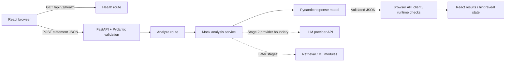

# Architecture

AlgoLens is a modular monolith: one backend application organized by responsibility and one browser client in the same repository. Separate development processes do not imply microservices. Stage 1 implements a complete request flow with fixed mock data.

Solid arrows are implemented. The dashed arrows are future work. Every valid statement returns the same teaching example, never a keyword-based guess or an inferred solution.

## Boundaries

- `frontend/src/App.tsx`: owns statement, pending/error/result state and an in-flight request reference. Editing clears stale results. New responses mount a fresh result component, resetting hint state.
- `frontend/src/components/ProblemInput.tsx`: accessible form, trimmed Unicode character count, matching length limits, loading and Clear controls. Editing is disabled while a request is pending so a result cannot silently apply to a different statement.
- `frontend/src/components/AnalysisResult.tsx`: renders five structured sections and a persistent mock warning. Reveals the three hints in order. All hints arrive in JSON; this is presentation behavior, not a server-side secrecy boundary.
- `frontend/src/components/HealthIndicator.tsx`: separate startup health check and manual recheck. API availability does not imply real AI availability.
- `frontend/src/services/api.ts`: all fetch calls, public backend base URL, JSON serialization, 15-second analysis timeout, controlled error messages, and runtime response checks. The client rejects malformed structures and out-of-order hint levels.
- `frontend/src/types/api.ts`: TypeScript contracts matching the backend, plus the shared-by-convention 20–20,000 character limits. Types disappear at runtime, so they do not replace response checks.
- `backend/app/api`: versioned paths and HTTP route handlers. FastAPI validates the request before invoking the analyze handler; the thin handler delegates to the service and declares its response model.
- `backend/app/schemas/analysis.py`: Pydantic request and nested response contracts. The request must be a strict string and is trimmed before inclusive length validation. Response type is explicitly `mock`. Confidence is omitted rather than invented.
- `backend/app/services/analysis_service.py`: returns a new typed demo response per call, independently of the request contents. No provider framework or SDK exists yet.
- `backend/app/core`: optional root .env configuration with process variables taking precedence. Exact allowed origins and GET/POST methods support the local development flow. Ports 5173 and 8000 make browser and backend different origins.
- `backend/tests`: HTTP contracts, validation and boundaries, mock determinism, and CORS via FastAPI's test client.
- `frontend/tests`: Playwright workflows in installed Edge at desktop and narrow viewports. Success paths use the actual API; failure cases intentionally intercept requests. Playwright owns both local server processes.
- `docs`: design rationale, verified milestones, and learning notes.

## Error and configuration flow

Invalid statements and malformed JSON use FastAPI's standard 422 responses; no custom exception framework is introduced. The frontend distinguishes network/configuration failures, request timeout, validation failure, other HTTP failures, unreadable JSON, and invalid response shape. The textarea remains populated on failure. An immediate request reference plus disabled controls prevents simultaneous submissions. Unmounting aborts the pending request.

`VITE_API_BASE_URL` is public browser configuration. `CORS_ORIGINS` controls which browser origins can read API responses. CORS is not authentication. No secrets or LLM credentials are needed. Input is sent to the local backend but is not stored or logged by application code; Uvicorn's normal access log records method/path/status.

## Future LLM integration

Stage 2 will add a small backend provider boundary to generate a story-free representation. Secrets remain server-side. Provider output must be parsed and validated into appropriate Pydantic schemas; malformed output, timeouts, and provider failures must produce controlled errors. Schema validation establishes structure, not semantic correctness, so reviewed evaluation examples are necessary.

The Stage 1 response deliberately permits only `analysis_type="mock"`. Stage 2 must explicitly revise the contracts and UI labeling so real fields, remaining demo fields, and unavailable fields cannot be confused. Do not simply send real outputs through a mock-labeled response.

Constraint extraction, deterministic complexity estimates, generated hints, retrieval, persistence, and ML experiments remain later milestones. Routes should not depend directly on training, dataset ingestion, or provider SDK objects.
