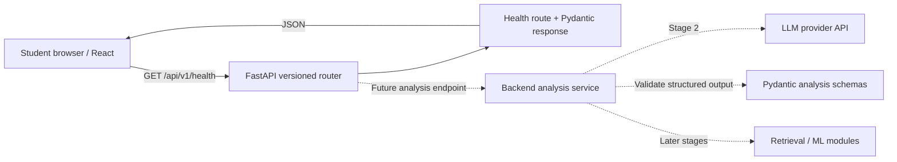

# Architecture

AlgoLens uses a modular monolith: one backend application organized by responsibility and one browser client in the same repository. Separate development processes do not imply microservices.

Only solid arrows exist in Stage 0. Analyze changes local page state. The health request uses a configurable backend base URL; the backend explicitly permits the local frontend origins through CORS. Ports 5173 and 8000 make them different origins even on the same machine.

## Boundaries

- `frontend/src/App.tsx`: owns the single page and ephemeral input/submission state. Components hold reusable UI. No feature page folders until there are multiple pages.
- `frontend/src/services`: owns HTTP and runtime response checks. `types` describes contracts for TypeScript; types alone cannot validate network data.
- `backend/app/api`: owns version prefixes, HTTP methods, status codes, request parsing, and response contracts. Routes should delegate substantial business logic to services.
- `backend/app/schemas`: owns runtime contracts through Pydantic. Health has literal status and service values.
- `backend/app/core`: reads environment configuration. Root .env is optional; process variables take precedence. CORS currently permits GET only; Stage 1 must deliberately add POST when its endpoint exists.
- `backend/app/services`: the future home of use-case logic; currently only a package marker. No speculative provider framework is implemented.
- `backend/tests`: checks observable API behavior without starting a real network server.
- `docs`: holds shared design rationale, milestones, and learning notes.

## Future analysis integration

Stage 1 will establish an explicit mock API contract and browser request states. Stage 2 will introduce a backend analysis service and a small provider boundary when a real provider is integrated. Secrets remain in backend environment variables. Provider output must be parsed and validated into Pydantic schemas before returning it; malformed outputs and provider failures must produce controlled errors. Routes handle HTTP details; services handle prompting, provider invocation, and validation orchestration.

Constraint extraction, deterministic complexity estimates, retrieval, and future ML experiments should enter as focused modules only in their milestones. Model research should be evaluated independently of the web UI. Do not couple route handlers to training pipelines, external dataset ingestion, or provider SDK objects. Persistence will be considered when a concrete use case needs it.

No server logging of problem statements, storage, authentication, retry framework, database, or deployment infrastructure is introduced now. The API currently exposes only process health and generated API docs.
