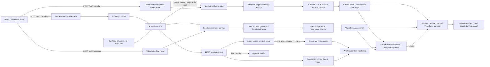

# Architecture

AlgoLens remains a modular monolith: one FastAPI backend and one React browser client. Stage 2 introduced the working Groq provider; Stage 3 added independent constraint/growth assessment. Stage 4 adds a local original practice catalog, TF-IDF/local semantic retrieval, standalone search, and provisional evaluation. No Groq inference was performed during Stage 4. Optional neural inference runs locally on CPU.

Health is a separate GET route and never initializes or contacts an LLM client. Imports, application startup, package installation, builds, generated API documentation, and tests make no inference calls.

## Boundaries and lifecycle

- `frontend/src/App.tsx` owns input, combined result, deterministic assessment, error, and the current analysis/assessment operation. An immediate request reference closes the gap before controls become disabled; unmounting aborts a pending browser request. Editing and new requests remove stale output. Both actions share validation and concurrency protection.
- `ProblemInput.tsx` shows the same 20–20,000 trimmed Unicode character bounds as the backend. Input and Clear are locked during requests; failures preserve text. Its description explains when text is sent to Groq.
- `AnalysisResult.tsx` renders mode/provider/model, nine semantic sections, null/empty states, uncertainties, and sequential hints. It depends on the shared response rather than SDK objects. All hints arrive at once; reveal buttons make no further requests and do not secure content from browser inspection.
- `AlgorithmicResult.tsx` renders original evidence, normalized bounds, contextual meanings, test counts/aggregates, resource limits, growth tables, caveats, and tentative discrepancies. It explicitly separates deterministic evidence from AI suggestions or unrelated demo examples. Tables scroll within their own region on narrow screens.
- `SimilarProblems.tsx` renders up to five local practice cards, method/source, finite cosine scores, tags, explanations, and limitations. Combined results start collapsed; standalone search starts expanded. No original record claims an external link. Input edits clear all stale output, and all three actions share concurrency/abort protection.
- `services/api.ts` handles all HTTP, public base URL, JSON, a 45-second deadline, shape/metadata checks, and controlled error-code messages. Types disappear at runtime, so network data is checked before rendering. Raw provider messages are not displayed.
- `backend/app/api/routes/analyze.py` declares both contracts. `/analyze` uses dependency injection, awaits AnalysisService, and returns AnalyzeResponse. `/assess` uses the same AnalyzeRequest and returns AlgorithmicAssessment without provider/configuration dependencies. There are no prompts or SDK details in either route.
- `services/analysis_service.py` runs deterministic assessment, makes the existing single provider call, validates content, and creates server-owned metadata/results. Exceptions cross the API boundary only as safe AnalysisError codes. No automatic fallback or repair request occurs; provider failure leaves the separate offline action available.
- `services/algorithmic_service.py` orchestrates parser and engine without provider/configuration access. Its separate comparison helper flags limited potential AI disagreements without replacing either source. Fake examples are never compared with the unrelated input.
- `algorithmic/numbers.py` implements a bounded Decimal numeric grammar and Unicode/source-offset normalization. `constraints.py` extracts numeric bounds and descriptive roles separately, intersects conjunctive bounds, retains conflicts, and distinguishes individual/aggregate scopes. `complexity.py` uses constant-time growth/log-space formulas and conservative aggregate upper bounds. No model, arbitrary expression evaluator, or third-party parser is used.
- `llm/base.py` is a Protocol: a name/model and an async `analyze(statement) -> AnalysisContent` method. Fake and Groq satisfy it without a class hierarchy or orchestration framework.
- `llm/fake_provider.py` returns a fresh deterministic example, independently of the input. It performs no inference, keyword matching, credential access, or network request.
- `llm/groq_provider.py` lazily creates AsyncGroq inside an analysis call. It fixes the host to the official Groq API, accepts only the two documented GPT-OSS model IDs, sets max_retries=0, applies token and total-time bounds, and closes the SDK client after the call. A configured model is never switched automatically.
- `llm/prompts.py` owns the educational, semantic-preservation, untrusted-input and no-solution policy. The user statement is serialized separately as data; credentials are never included in either message. Prompt instructions and code-fence rejection do not prove semantic correctness or disclosure safety.
- `schemas/analysis.py` separates model-generated AnalysisContent from trusted AnalyzeResponse metadata, required deterministic data, and optional retrieval data/warnings. `schemas/analysis_input.py` shares the existing input contract without creating a response-schema import cycle. `schemas/algorithmic.py` owns numeric evidence; `schemas/retrieval.py` validates catalog, bounded K, provenance, finite cosine scores, and requested/actual retrieval methods. The provider generation schema is unchanged. Generation objects forbid extras and require every field; unknown semantic values use explicit null. Backend validators enforce nonblank text, no fenced code, and exactly three hints ordered 1–3.
- `core/config.py` merges optional root .env with process environment taking precedence, without mutating os.environ. Fake is the default. SecretStr is excluded from the settings repr. Invalid settings produce a safe configuration error rather than echoing values.
- `core/errors.py` defines fixed public messages; main.py serializes these through one exception handler. No raw SDK error, output body, key, or authorization header is logged by application code.

## Strict generation and response metadata

Groq receives the JSON Schema generated from AnalysisContent using `response_format.type=json_schema` and `strict=true`. All object properties are required and objects are closed, including nested definitions. Nullable values use unions; runtime validators enforce hint count/order and text rules without adding complex schema constructs. The adapter rejects missing/truncated content, malformed JSON, and invalid data instead of retrying or silently dropping validation.

Only semantic fields go to the model. AnalysisService sets provider metadata, `deterministic`, `similar_problems`, and `retrieval_warning`. Fake responses must be `mock/fake/null` with a demo notice; Groq responses must be `ai/groq/configured-model` without one. Pydantic and browser checks enforce that combination. Deterministic results always come from the actual submitted text. Retrieval in fake mode also uses actual input; real AI simplification is reused only when no uncertainty was reported, with explicit provenance and no independent-fidelity claim.

Raw provider constraints, technique suggestions, observations and complexity comments in AI mode remain preliminary. The deterministic field has its own source label and limitations: it handles a small mathematical/English grammar, requires contextual size meanings, and evaluates hypothetical growth with transparent bands. It does not verify algorithms or semantics. See [the Stage 3 guide](DETERMINISTIC_ANALYSIS.md). Retrieval is ranking over original task text, not verified algorithm classification; its measured limitations and provisional labels are in [the Stage 4 guide](RETRIEVAL.md).

## Retrieval boundaries

SimilarProblemService has no LLM dependency. Both the standalone route and AnalysisService use the same service. TF-IDF fits once per revision; MiniLM encodes the corpus once and each query separately. Technique labels and relevance judgments never enter the representation. Rankings use cosine and stable ID tie-breaking. Semantic loading/encoding failure visibly falls back to TF-IDF; standalone catalog/configuration failures return a safe 503. Optional integrated failures/timeouts retain the successful analysis and hints.

Two in-memory indexes and one encoder are retained per process, protected by a lock. Catalog bytes plus representation version identify the corpus. Model ID/directory/file statistics identify the local model. CPU work is offloaded from the event loop. Integrated search has a three-second wait budget; a timed-out worker may finish warming the cache. No persistent embedding store, FAISS, Redis, database, or cloud service exists.

Only `python -m app.retrieval.setup_model --download` can download weights. It fetches selected files at a resolved commit into ignored .cache, verifies CPU encoding, and records local identity. Runtime uses `local_files_only=True`, `trust_remote_code=False`, and CPU. Missing setup never triggers a hosted API or download. Dependencies are optional through the semantic extra; base scikit-learn enables key-free local development. The explicit model download/resource policy and measured 87.3 MiB cache are documented in RETRIEVAL.md.

## Budget, errors, and local configuration

Default fake mode and the independent offline assessment need no key or external service after installation. Groq mode requires the user's deliberate backend selection and an Analyze submission. There is one non-streaming request, default 3,072 maximum completion tokens with low reasoning effort, and a default 30-second total deadline (configurable up to 40). The browser waits up to 45 seconds. A character limit does not guarantee staying below an account's token quota. Stage 3 adds no dependencies and no model calls.

Status mapping: configuration/auth/model-access 503, quota 429, timeout 504, invalid output 502, unavailable 503, unexpected internal error 500. Messages never use raw exceptions. No paid fallback, auto-upgrade, automatic retry, startup model probe, or model-list request is implemented. The app cannot inspect an account's billing plan; manual setup must stay on Groq Free, and fake mode remains available if free access is unavailable.

Exact local CORS origins and GET/POST are retained. Ports 5173 and 8000 are distinct origins; JSON POST uses a preflight. CORS is not authentication. Backend settings stay in the root .env/process environment; frontend VITE_API_BASE_URL is public. No real environment files are overwritten. Existing .gitignore patterns cover nested .env files.

## Offline verification and future work

Backend tests replace .env reads, force fake defaults, block external DNS/socket connections, and exercise the actual Groq SDK with httpx.MockTransport. Browser tests force fake mode and an empty key regardless of local live settings; external page requests are blocked. The AI result branch is tested with an explicit synthetic response. No test requires a live provider, key, or quota.

Stage 4 verification: 248 backend tests, 52 desktop/mobile tests in the final complete browser run, and the production build pass. Tests preserve previous behavior and add catalog validation, cosine/ranking, fake encoders, cache invalidation, metrics, fallback, import/download guards, source labels, and retrieval-failure isolation. Real MiniLM was verified separately through offline evaluation and an API smoke check with external connections blocked. Live Groq was not called. Provisional 14-query evaluation results, including failures and story-pair overlap, are recorded in retrieval_results.json. The earlier semantic/hint rubric in EVALUATION.md remains useful.

A future OllamaProvider could implement the same content protocol, but is not implemented. The user's Stage 4 retrieval request supersedes the previous hint-quality milestone ordering. Stage 5 might strengthen retrieval with algorithm-aware features and reviewed labels, only when requested. Persistence, training, reranking, and production infrastructure remain outside this stage.
