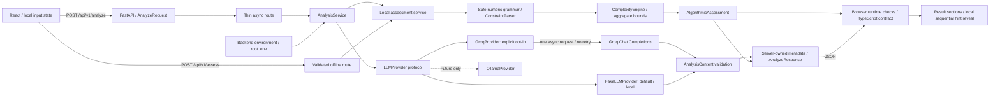

# Architecture

AlgoLens remains a modular monolith: one FastAPI backend and one React browser client. Stage 2 introduced the opt-in Groq provider; the user reports it working. Stage 3 adds independent local extraction and growth assessment, preserves the provider contract, and exposes an entirely offline endpoint. No live inference was performed during Stage 3 development.

Health is a separate GET route and never initializes or contacts an LLM client. Imports, application startup, package installation, builds, generated API documentation, and tests make no inference calls.

## Boundaries and lifecycle

- `frontend/src/App.tsx` owns input, combined result, deterministic assessment, error, and the current analysis/assessment operation. An immediate request reference closes the gap before controls become disabled; unmounting aborts a pending browser request. Editing and new requests remove stale output. Both actions share validation and concurrency protection.
- `ProblemInput.tsx` shows the same 20–20,000 trimmed Unicode character bounds as the backend. Input and Clear are locked during requests; failures preserve text. Its description explains when text is sent to Groq.
- `AnalysisResult.tsx` renders mode/provider/model, nine semantic sections, null/empty states, uncertainties, and sequential hints. It depends on the shared response rather than SDK objects. All hints arrive at once; reveal buttons make no further requests and do not secure content from browser inspection.
- `AlgorithmicResult.tsx` renders original evidence, normalized bounds, contextual meanings, test counts/aggregates, resource limits, growth tables, caveats, and tentative discrepancies. It explicitly separates deterministic evidence from AI suggestions or unrelated demo examples. Tables scroll within their own region on narrow screens.
- `services/api.ts` handles all HTTP, public base URL, JSON, a 45-second deadline, shape/metadata checks, and controlled error-code messages. Types disappear at runtime, so network data is checked before rendering. Raw provider messages are not displayed.
- `backend/app/api/routes/analyze.py` declares both contracts. `/analyze` uses dependency injection, awaits AnalysisService, and returns AnalyzeResponse. `/assess` uses the same AnalyzeRequest and returns AlgorithmicAssessment without provider/configuration dependencies. There are no prompts or SDK details in either route.
- `services/analysis_service.py` runs deterministic assessment, makes the existing single provider call, validates content, and creates server-owned metadata/results. Exceptions cross the API boundary only as safe AnalysisError codes. No automatic fallback or repair request occurs; provider failure leaves the separate offline action available.
- `services/algorithmic_service.py` orchestrates parser and engine without provider/configuration access. Its separate comparison helper flags limited potential AI disagreements without replacing either source. Fake examples are never compared with the unrelated input.
- `algorithmic/numbers.py` implements a bounded Decimal numeric grammar and Unicode/source-offset normalization. `constraints.py` extracts numeric bounds and descriptive roles separately, intersects conjunctive bounds, retains conflicts, and distinguishes individual/aggregate scopes. `complexity.py` uses constant-time growth/log-space formulas and conservative aggregate upper bounds. No model, arbitrary expression evaluator, or third-party parser is used.
- `llm/base.py` is a Protocol: a name/model and an async `analyze(statement) -> AnalysisContent` method. Fake and Groq satisfy it without a class hierarchy or orchestration framework.
- `llm/fake_provider.py` returns a fresh deterministic example, independently of the input. It performs no inference, keyword matching, credential access, or network request.
- `llm/groq_provider.py` lazily creates AsyncGroq inside an analysis call. It fixes the host to the official Groq API, accepts only the two documented GPT-OSS model IDs, sets max_retries=0, applies token and total-time bounds, and closes the SDK client after the call. A configured model is never switched automatically.
- `llm/prompts.py` owns the educational, semantic-preservation, untrusted-input and no-solution policy. The user statement is serialized separately as data; credentials are never included in either message. Prompt instructions and code-fence rejection do not prove semantic correctness or disclosure safety.
- `schemas/analysis.py` separates model-generated AnalysisContent from trusted AnalyzeResponse metadata and the required deterministic object. `schemas/algorithmic.py` owns structured numeric evidence, scope/role/reliability categories, finite work estimates, and explicit unknowns. The provider generation schema is unchanged. Generation objects forbid extras and require every field; unknown semantic values use explicit null. Backend validators enforce nonblank text, no fenced code, and exactly three hints ordered 1–3.
- `core/config.py` merges optional root .env with process environment taking precedence, without mutating os.environ. Fake is the default. SecretStr is excluded from the settings repr. Invalid settings produce a safe configuration error rather than echoing values.
- `core/errors.py` defines fixed public messages; main.py serializes these through one exception handler. No raw SDK error, output body, key, or authorization header is logged by application code.

## Strict generation and response metadata

Groq receives the JSON Schema generated from AnalysisContent using `response_format.type=json_schema` and `strict=true`. All object properties are required and objects are closed, including nested definitions. Nullable values use unions; runtime validators enforce hint count/order and text rules without adding complex schema constructs. The adapter rejects missing/truncated content, malformed JSON, and invalid data instead of retrying or silently dropping validation.

Only semantic fields go to the model. AnalysisService sets `analysis_type`, `provider`, `model`, `demo_notice`, and `deterministic`. Fake responses must be `mock/fake/null` with a demo notice; Groq responses must be `ai/groq/configured-model` without one. Pydantic and browser checks enforce that combination. Provider-returned model labels are not trusted as metadata. Deterministic results always come from the actual submitted text, including in fake mode.

Raw provider constraints, technique suggestions, observations and complexity comments in AI mode remain preliminary. The new deterministic field has its own source label and limitations: it handles a small mathematical/English grammar, requires contextual size meanings, and evaluates hypothetical growth with transparent bands. It does not verify algorithms or semantics. See [the Stage 3 guide](DETERMINISTIC_ANALYSIS.md) for safe-number limits, aggregate formulas, unavailable cases, and pattern extension instructions. Retrieval and verified algorithm classification remain unimplemented.

## Budget, errors, and local configuration

Default fake mode and the independent offline assessment need no key or external service after installation. Groq mode requires the user's deliberate backend selection and an Analyze submission. There is one non-streaming request, default 3,072 maximum completion tokens with low reasoning effort, and a default 30-second total deadline (configurable up to 40). The browser waits up to 45 seconds. A character limit does not guarantee staying below an account's token quota. Stage 3 adds no dependencies and no model calls.

Status mapping: configuration/auth/model-access 503, quota 429, timeout 504, invalid output 502, unavailable 503, unexpected internal error 500. Messages never use raw exceptions. No paid fallback, auto-upgrade, automatic retry, startup model probe, or model-list request is implemented. The app cannot inspect an account's billing plan; manual setup must stay on Groq Free, and fake mode remains available if free access is unavailable.

Exact local CORS origins and GET/POST are retained. Ports 5173 and 8000 are distinct origins; JSON POST uses a preflight. CORS is not authentication. Backend settings stay in the root .env/process environment; frontend VITE_API_BASE_URL is public. No real environment files are overwritten. Existing .gitignore patterns cover nested .env files.

## Offline verification and future work

Backend tests replace .env reads, force fake defaults, block external DNS/socket connections, and exercise the actual Groq SDK with httpx.MockTransport. Browser tests force fake mode and an empty key regardless of local live settings; external page requests are blocked. The AI result branch is tested with an explicit synthetic response. No test requires a live provider, key, or quota.

Stage 3 verification: 171 backend tests, 40 browser tests across desktop/mobile, and the production build pass. Backend cases include unsupported notation, role ambiguity, conflicts, values versus sizes, growth overflow safety, aggregate formulas, an independent endpoint under invalid provider settings, one provider call, and safe errors. Browser cases preserve existing hints and check offline recovery, both sources, missing/conflicting sizes, and discrepancies. Live Groq was not called; Stage 2 working status comes from the user's handoff. The semantic rubric in EVALUATION.md remains useful because JSON validation cannot establish factual accuracy, task equivalence, technique correctness, or appropriate hint restraint.

A future OllamaProvider can implement the same protocol and AnalysisContent contract. Adding its metadata to backend/frontend types will not require provider-specific branches in the route or result component. It is not implemented here. Hint-quality evaluation is the next planned stage, only when requested; persistence, retrieval, and advanced NLP remain later milestones.
